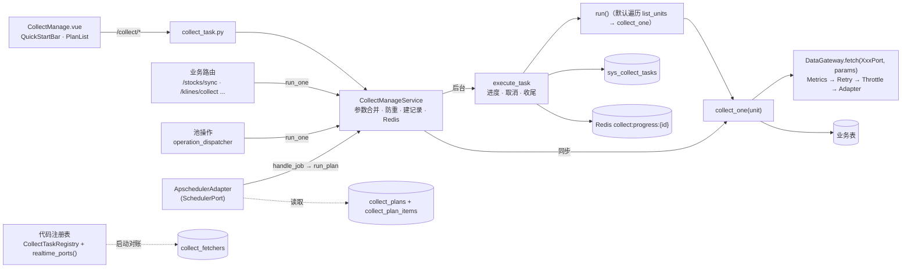
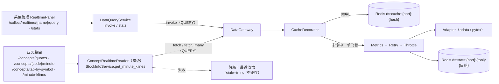

# 采集管理 · 摘要

页面：`frontend/src/views/collect-manage/CollectManage.vue`（标签页：采集接口 / 采集方案）
接口：`/api/v1/collect/*`（`backend/src/contexts/collect/interface/route/collect_task.py`）
应用服务：`backend/src/contexts/collect/application/service/collect_manage_service.py`（`CollectManageService`，注入 `gateway`）
框架：`backend/src/shared/infrastructure/adapter/collect/`（**step7 上移到 shared**）；调度器：`shared/infrastructure/adapter/scheduler/apscheduler_adapter.py`（`SchedulerPort` 实现）
数据入口：`backend/src/shared/infrastructure/adapter/data/`（`DataGateway` + 装饰器 + tushare / adata / pytdx Adapter），接口约束 `backend/src/contexts/collect/application/port/data/`
实时接口：声明了 `cache` 的数据 Port（缓存由 `shared/infrastructure/adapter/data/core/cache.py` 的 `CacheDecorator` 负责，交易时段规则来自 `contexts/market/domain/service/market_session.py` —— step7 重构后从 `collect.domain` 移到了 `market.domain`）；试查 / 统计走 `contexts/collect/application/service/data_query_service.py` 的 `DataQueryService`
方案：[`04-修订方案`](../dev/step2/04采集管理优化/04-修订方案.md)（S0–S4 已实施）、[`05接口优化`](../dev/step2/04采集管理优化/05接口优化.md)、[`06实时数据接口`](../dev/step2/04采集管理优化/06实时数据接口.md)（已实施）、[`step5/02底层采集优化`](../dev/step5/02底层采集优化/README.md)（P1–P6 已实施）

> 最后更新：2026-10-17（**step7 统一 DDD 重构**）
> - `infrastructure/adapter/collect/` 已上移到 `shared/infrastructure/adapter/collect/`（被 collect / market / concept 等多个 context 复用）
> - `application/port/data/` 路径改为 `contexts/collect/application/port/data/`（仍属 collect context，外部仅按 Gateway 取数）
> - `domain/service/market_session.py` 从 `collect` 移到 `market`（概念性服务归属"市场域"更合理）
> - 路由文件 `route/api/v1/collect_task.py` → `contexts/collect/interface/route/collect_task.py`
>
> 2026-10-13（**底层采集优化**）
> - 取数统一走 `DataGateway`；旧 `XxxFetcher` / `get_registry()` / `adapter/fetcher/` / `adapter/realtime/`（`RealtimeQueryFramework` / `BaseRealtimeQuery`）已删除
> - 14 个 tushare 任务改为 `DeclarativeCollectTask`（集中在 `tushare_tasks.py`，`task_type` 不变）
> - 实时接口 Redis 键改为 `ds:cache:*` / `ds:lock:*` / `ds:stats:*`；概念行情降级移到 `ConceptRealtimeReader`
>
> 2026-10-05（**任务数对账 + 任务组移除**）
> - §3 批量接口从「7 可用 + 14 占位」修正为 **21 ready + 2 planned**（原文档严重滞后）
> - `concept_reason` / `concept_snapshot` **已实现**（原写「已去除」有误），快照表正常写入 390 行
> - 「任务组」概念**已彻底移除**，统一为「采集方案 + 方案项」两表

## 1. 现状一句话

采集管理里有两类接口，共用一棵四面目录树（catalog 用 `kind` 区分）：

| 类型 | 基类 | 结果去向 | 管理方式 |
|---|---|---|---|
| 批量接口 `kind=batch` | `BaseCollectTask`（tushare 14 个为 `DeclarativeCollectTask`） | 入库 | 任务记录、采集方案（`collect_plans` + `collect_plan_items`） |
| 实时接口 `kind=realtime` | 声明了 `cache` 的数据 Port（`DataPort`） | 只写 Redis（交易时段 15 秒） | 试查、调用统计；不建任务、不能加入采集方案 |

批量接口的三种用法共用一套采集 + 落库逻辑：

| 用法 | 入口 | 执行方式 |
|---|---|---|
| 后台批量 | 采集管理页手动启动 / **采集方案**定时触发 | `CollectManageService.submit` → `execute_task`，有进度与记录 |
| 业务小范围 | `/stocks/sync`、`/klines/collect` 等业务路由、池操作 | `CollectManageService.run_one` → `collect_one`，同步返回，不建记录 |
| 按顺序批量 | 采集方案（手动 / 定时） | `run_plan`：逐项 `prepare` + `execute_task`，记录用 `plan_run_id` 归组 |

## 2. 执行链路

- **参数优先级**：调用方传入 > 方案项 `collect_plan_items.params` > 任务类 `default_params`（`run_one` 不读方案，只合并 `default_params`）。
- **防重**：同 `task_type` 已有 `running` 记录时拒绝（手动、定时、方案执行共用）。启动时把残留的 `running` 记录标为 `failed`（单进程假设）。
- **取消**：`POST /collect/tasks/{id}/cancel` 写进程内标志，单元之间检查；`execute_task` 还会设置 `context.cancel_check`，装饰器里的限频 / 重试等待也会及时中断；`force=true` 直接改记录。服务关闭时后台协程被取消，记录标 `cancelled`。
- **状态**：只有 `success == 0 且 fail > 0` 才算 `failed`。
- **默认 `run()`**：按 `concurrency` 分批执行 `collect_one`，抛异常的单元在末尾间隔 `retry_delay` 重试一轮。

## 3. 批量接口（21 个 ready + 2 个 planned）

> 完整参数契约见 [`采集数据接口.md`](采集数据接口.md)。此处只列骨架。

### 3.1 按面分布

| 面 | task_type（全部 `ready`） |
|---|---|
| 技术面 | `daily_kline` · `base_adj_factor` · `base_suspend` · `base_name_change` |
| 资金面 | `cap_moneyflow` · `cap_margin_detail` · `cap_top_list` · `cap_top_inst` · `cap_block_trade` · `cap_holder_num` |
| 基本面·估值财报 | `stock_basic` · `daily_basic` · `fin_report` · `base_dividend` |
| 基本面·股东 | `fin_top10_holders` · `fin_top10_floatholders` |
| 基本面·概念 | `concept` · `concept_membership` · `concept_index_th` · `concept_reason` · `concept_snapshot` |

### 3.2 常用接口速查

| task_type | 分类 | 单元 | `collect_one` | 默认参数 | 写入表 |
|---|---|---|---|---|---|
| `daily_kline` | tech / kline | 股票 | ✓（业务复用） | `days=7` | `tech_kline_dailys`（仅 OHLCV） |
| `stock_basic` | fundamental / core | `all` | ✓ | `list_status=L` | `stock_infos` |
| `daily_basic` | fundamental / valuation | 交易日 | ✓ | `days=1` | `fin_daily_basics` |
| `fin_report` | fundamental / report | 股票 | ✓ | `years=1` | `fin_reports` |
| `concept` | fundamental / concept | 一次全量 | — | | `concepts` |
| `concept_membership` | fundamental / concept | 概念 index_code | ✓ | | `stock_concept_members` |
| `concept_index_th` | fundamental / concept | 概念 | — | | `concept_index_ths` |
| `concept_reason` | fundamental / concept | 股票 | ✓ | `only_missing=true` | `stock_concept_members.reason` |
| `concept_snapshot` | fundamental / concept | 概念 | — | | `concept_snapshots` |

- 14 个 tushare 任务（`daily_basic` / `fin_report` / `cap_*` / `fin_top10_*` / `base_*`）为 `DeclarativeCollectTask`，集中声明在 `tushare_tasks.py`（Port + 规划器 `TradeDatePlanner` / `SymbolPlanner` + 仓储），限频 / 重试由 Gateway 装饰器统一处理。
- `daily_kline` / `stock_basic` 经 `StockInfoService` → Gateway 取数；`daily_kline` 批量时保留自定义 `run()`（`run_units` 并发，限频交给 Gateway 的 `tushare` 限流组），支持 `symbols` / `exchange` / `start_date`+`end_date` / `concurrency`。
- 概念全部来自同花顺（adata），以 `index_code`（885xxx）为键。依赖顺序：`concept` → `concept_membership` → `concept_reason`；`concept` → `concept_index_th`。可在同一采集方案内按 `sort_order` 串行执行。
- ⚠️ **默认窗口偏小**：多数 `cap_*` 与 `daily_basic` 的 `default_params` 是 `{"days": 1}`，**首次使用必须显式传 `days=N` 回填**。
- ⚠️ **`cap_holder_num` 覆盖度极低**：142 行 / 仅 1 只股票，需逐只全量回填。
- **planned 占位任务 2 个**（`planned.py`，不能启用定时、不能加入方案）：
  - `minute_kline`（分钟 K **入库**版）—— pytdx 源实测挂死 >3.7min；实时查询已由 `MinuteKlinePort`（实时接口 `stock_minute_kline`）单独提供
  - `news_article` —— tushare news 权限未开通 + ORM 未建
  
  实现一个 = 数据 Port（`application/port/data/`）+ Adapter（`adapter/data/<工具>/`，在 `setup.py` 注册）+ 任务（优先 `DeclarativeCollectTask` 声明，或子类实现 `list_units` + `collect_one`）+ 状态改 `ready`。

## 4. 实时接口（2 个）

| name | 分类 | 数据源 | 参数 | 数据 | 降级 |
|---|---|---|---|---|---|
| `concept_minute`（`ConceptMinutePort`） | fundamental / concept | 同花顺 `get_market_concept_min_ths`（`AdataConceptMinuteAdapter`） | `index_code` | 当日分时 `points` + 头部 `pre_close / price / change / change_pct / trade_time`（`pre_close = price - change`） | 业务侧由 `ConceptRealtimeReader` 回落 `concept_index_ths` 最近一条收盘（无分时，`stale=true`）；采集管理试查不降级 |
| `stock_minute_kline`（`MinuteKlinePort`） | tech / kline | 通达信 pytdx（`PytdxMinuteKlineAdapter`） | `symbol, interval, days`（1min 仅 1 天，其他 1–5 天；`count` 已移除） | 分钟 K 线 | 无 |

- **缓存**：工作日 09:25–11:30、13:00–15:00 缓存 15 秒（Port 的 `cache.ttl_trading`）；午休缓存到 13:00；其余时段缓存到下个工作日 09:25（节假日按工作日处理）。规则在 `domain/service/market_session.ttl_for`。
- **单飞**：`SET ds:lock:{port}:{hash} NX EX 5`，没抢到锁的请求最多等约 2 秒后重读缓存。
- **限流**：`ThrottleDecorator` 按限流组共享进程内信号量，`adata:ths=5`、`tdx=1`；QUERY 策略下只占并发、不排间隔，单次取数超时 10 秒（→ `SourceUnavailable` → 502）。`PytdxClient` 内部另有 `threading.Lock`（单连接不线程安全）；北交所代码（8/4/92 开头）直接返回 400。
- **统计**：`MetricsDecorator` 写 `ds:stats:{port}:{tool}:{yyyymmdd}`（calls / errors / latency_sum / last_error），`CacheDecorator` 写 `ds:stats:{port}:cache:{yyyymmdd}`（hits / misses），保留 7 天；`GET /collect/realtime/{name}/stats` 由 `gateway.stats` 汇总出命中率、平均耗时、最近错误。
- **Redis 不可用**时直连数据源、不缓存。
- 新增实时接口 = 在数据 Port 上声明 `cache = CachePolicy(ttl_trading=..., consumers=...)` + 对应 Adapter；`realtime_ports()` 自动把它并入 catalog 与 `collect_fetchers` 对账，无需单独注册。需要降级时在应用层 Service 里处理（参考 `ConceptRealtimeReader`）。
- 与 `planned.py` 的占位 `minute_kline`（分钟 K **入库**）是两回事。

## 5. 采集方案（三表架构，2026-10-05 重构）

设计文档：`docs/dev/step3/05采集管理优化/`

| 表 | 关键字段 | 说明 |
|---|---|---|
| `collect_fetchers` | PK `task_type`、`label`、`facet` / `sub_facet`、`kind`（batch / realtime）、`status`（ready / planned / orphan）、`default_params`、`supports_run_one`、`sort_order` | **代码注册表的 DB 镜像**，启动期 `_sync_fetcher_catalog()` 自动对账（补录 / 更新 / 标 orphan）。不是配置源 |
| `collect_plans` | PK `id`、`name`、`enabled`、`schedule_type`（`time` / `interval` / `NULL`）、`times`（`["09:30","15:00"]`）、`interval_seconds`、`stop_on_fail`、`last_run_at` / `last_task_id` | 方案 = **触发配置 + 编排策略**。不再与 task_type 1:1 |
| `collect_plan_items` | PK `id`、FK `plan_id`（CASCADE）、FK `task_type` → `collect_fetchers.task_type`、`params`、`enabled`、`sort_order`、唯一约束 `(plan_id, task_type)` | 方案 ↔ 接口的 **M:N 关联**，携带各接口参数与执行顺序 |
| `sys_collect_tasks.plan_run_id` | 可空 | 同一次方案执行共享，取第一项的 `task_id`（由 `group_run_id` RENAME 改名而来，数据保留） |

- **调度器**：规则在 domain `Schedule` 值对象（`domain/entitys/collect_plan/vo.py`，非法抛 `InvalidSchedule(ValueError)`）；Service 只依赖 `SchedulerPort`（`upsert` / `remove` / `next_run` / `on_fire`），key = `plan:{plan_id}`，payload = `{"plan_id": id}`。实现 `ApschedulerAdapter`（`AsyncIOScheduler`，`Asia/Shanghai`）：
  - 定时模式：每个时间点一个 job，`plan:{plan_id}@{HH:MM}` + `CronTrigger(hour, minute)`
  - 定频模式：单 job `plan:{plan_id}` + `IntervalTrigger(seconds)`，**下限 30 秒**
  - `upsert()` 每次先 `remove(key)` 清旧 job（匹配精确到 `key + "@"`，`plan:1` 不会误删 `plan:11`）
  - `next_run` = 该 key 下所有 job 最早的下次触发时间（Service 传给 `plan_to_dict`）
  - 启动：`restore_schedules()` 读方案表注册定时；到点 `handle_job()` → `run_plan(trigger="schedule")`
  - 开关：`.env` 设 `COLLECT_SCHEDULER_ENABLED=false` 可关闭定时（此时方案只能手动执行）
- **触发方式**：`schedule_type=NULL` = 仅手动（不注册 job）；`time` 需 `times` 非空且格式严格 `HH:MM`（≤24 个）；`interval` 需 `interval_seconds ≥ 30`。
- **方案执行规则**：按 `sort_order` 串行；某项已在运行 → 跳过继续；某项 `failed` / `cancelled`（或「零成功但有失败」）且 `stop_on_fail` → 停止后续项。实时接口不能加入方案（前端过滤 + `_validate_items` 校验）。
- **只做方案卡片的最小实现**：`trading_day_only`（仅交易日）已随旧「任务组」一并移除，交易日历接入后再评估。

## 6. API

| 端点 | 说明 |
|---|---|
| `GET /collect/catalog` | 四面目录树；每个接口带 `kind`、`default_params`、`supports_run_one`；实时接口另带 `source`、`ttl_trading`、`consumers` |
| `GET /collect/fetchers` | 采集接口元数据列表（`collect_fetchers` 表镜像）—— 方案编排的接口选择器数据源 |
| `POST /collect/realtime/{name}/query` | 调用实时接口（`DataQueryService.query`，最多 5000 条），body 为参数；返回 `{data: BO 列表, cached, stale（恒 false）, fetched_at, latency_ms}`；参数错误 400，数据源失败 502 |
| `GET /collect/realtime/{name}/stats?days=1` | 实时接口按天调用统计（命中率、平均耗时、最近错误） |
| `POST /collect/tasks` | 创建任务 `{task_type, params}`；冲突时 200 + `data.message`（无 `task_id`） |
| `GET /collect/tasks` | 分页，可按 `task_type` / `status` / `plan_run_id` 过滤 |
| `GET /collect/tasks/{id}` / `/progress` | 详情 / Redis 实时进度 |
| `POST /collect/tasks/{id}/cancel` | 取消（`force` 强制） |
| `GET /collect/plans`、`GET /collect/plans/{plan_id}` | 采集方案列表 / 详情（含 `items`、`next_run_at`） |
| `POST /collect/plans` | 新建方案（保存后同步刷新定时 job） |
| `PUT /collect/plans/{plan_id}` | 更新方案（全量替换 `items`） |
| `DELETE /collect/plans/{plan_id}` | 删除方案（`collect_plan_items` 由 FK CASCADE 一并清理，并注销定时 job） |
| `POST /collect/plans/{plan_id}/run` | 立即执行一次方案（后台按 `sort_order` 串行） |

## 7. 业务侧入口（均已改为调采集接口 / 实时接口）

| 业务路由 | 前端调用处 | 实现 |
|---|---|---|
| `POST /stocks/sync` | `stock-info` 同步股票 | `run_one("stock_basic", "all", {list_status})` |
| `POST /stocks/sync-daily-basic` | — | 逐日 `run_one("daily_basic", trade_date)` |
| `POST /klines/collect` | `stock-info` K 线抽屉 | `run_one("daily_kline", symbol, {days / start_date / end_date})` |
| `POST /klines/collect/batch` | — | 逐只 `run_one`，单只失败 `saved_count=-1`；大批量请用 `POST /collect/tasks` + `symbols` |
| 池操作（`operation_dispatcher.py`） | 操作池页 | 逐只 `run_one("daily_kline", ...)` |
| `GET /minute-klines/{symbol}?interval&days` | 股票列表展开行分 K（15 秒轮询） | `StockInfoService.get_minute_klines` → `gateway.fetch(MinuteKlinePort, QUERY)`；响应多 `cached`、`fetched_at` |
| `GET /concepts/quotes?codes=`（≤100） | 详情抽屉概念 Tab（15 秒轮询） | `ConceptRealtimeReader.minutes` → `gateway.fetch_many(ConceptMinutePort, QUERY)`，返回 `{index_code: quote}` |
| `GET /concepts/{index_code}/minute` | 概念分时图（后续） | `ConceptRealtimeReader.minute` 整条数据 |
| `GET /concepts/tab-by-symbol/{symbol}` | 详情抽屉概念 Tab | 各概念 `snapshot` 由 `ConceptRealtimeReader`（`concept_minute`）填充，组内按涨跌幅降序 |

## 8. 前端文件

| 文件 | 作用 |
|---|---|
| `CollectManage.vue` | 页面：标签页（采集接口 / 采集方案）；左侧四面树（实时接口带「实时」标签）+ 右侧启动区、任务列表（含「来源」列：手动 / 定时 / 方案）；选中实时接口时右侧换成 `RealtimePanel` |
| `RealtimePanel.vue` | 实时接口：基本信息（数据源 / 缓存策略 / 调用方）、试查（参数表单 → 耗时、是否命中缓存、前 20 行预览）、今日调用统计 |
| `PlanList.vue` | 采集方案列表 + 编辑弹窗（触发方式：每日定时多时间点 / 固定频率（秒·分·时，下限 30 秒）/ 仅手动；接口编排：选接口 + 参数 JSON + 排序 + 单项启停；失败即停）+ 执行 + 最近一次执行记录 |
| `QuickStartBar.vue` / `AdvancedFilters.vue` | 快捷参数按钮 / `daily_kline` 高级条件 |
| `composables/useCatalog.ts` / `useCollectTasks.ts` | 目录树 / 任务列表与进度轮询 |
| `api.ts` | `/collect/*` 接口封装与类型（含 `queryRealtime` / `getRealtimeStats`、`listFetchers`、`scheduleLabel`、`formatInterval`） |
| `frontend/src/composables/useRealtimePoll.ts` | 通用实时轮询：仅交易时段 + 页面可见时按间隔执行，请求未返回跳过，连续失败 3 次暂停 |

## 9. 已知问题

- **🔴 `concept` 任务挂死会堵死整个后端**（2026-10-05 23:43 实测确认，**最高优先级**）：任务 id=85（`concept`，`schedule` 触发，23:25:56 启动）跑超 17 分钟未结束，期间 `GET /health` 与 `GET /collect/fetchers` **全部超时**（8s/60s），前端整体不可用。**DB 正常**（独立进程 `SELECT 1` 仅 628ms）→ 根因在后端进程内，疑为 `concept` 全量拉 390 个概念的 adata 调用未正确让出事件循环或数据源调用内同步阻塞（当时仍是旧 `AdataConceptFetcher`）。**建议**：① 先重启后端；② 查 `collect/concept.py` 的 `run()` 与 `adapter/data/adata/`（`AdataClient` / 概念 Adapter）；③ 给采集任务加**看门狗超时**（超 N 分钟强制 cancel），或把采集挪到独立进程。
- **`concept` 定时触发连续失败**：23:18~23:25 `trigger_type=schedule` 的 `concept` 连续 3 条 `failed` + 1 条 `cancelled`（手动触发历史上可成功），与上一条很可能同源。
- 取消标志、调度器、残留 `running` 清理、`ThrottleDecorator` 的限流组信号量都假设**单进程**；多 worker 部署需要改为 Redis 锁 / 独立调度进程。
- 看板阶段计划用 SSE（`GET /realtime/stream?subs=...`）替代轮询，本期未做；pytdx 仍是单连接加锁，未做连接池。
- **已完成（底层采集优化 P5 / P6）**：定时调度改造（Service 不再 import 调度器实现）；`/api/v1/data/catalog`、`/api/v1/data/{name}` 按名调用（未知 404 / 参数 422 / 无实现 400 / 全部源失败 503 带 `attempts`）与 Agent 工具目录。遗留：`collect_plan` 实体与仓储接口、多副本调度互斥未做。
- 定频方案下限 30 秒：低于此值任务永远跑不完（每轮触发都 TaskConflict），且极易打爆数据源配额。
- **⚠️ `PlanList.vue` 触发时间「添加」按钮曾完全失效**（2026-10-05 已修）：原模板把「添加时间」按钮放在 `v-if="!form.times.length"` 分支，而 `el-time-picker` 放在 `v-else` 分支——两者条件互斥，导致新建方案时按钮可见但选择器不可见、`addTime()` 永远静默 return。已改为选择器与按钮常驻、tag 列表按需渲染。
- 前端 `stock-info/api.ts` 里的 `/moneyflows/*` 等接口后端尚未实现。
- 前端 `vue-tsc -p tsconfig.app.json` 在 `stock-info` / `stock-pool` / `market` 等目录仍有 `http.get<T>().then(unwrap)` 泛型写法导致的类型错误（`collect-manage` 已改为 `ApiResponse<T>`）。

## 10. DDD 重构（2026-10-02）

把"领域规则"和"技术框架"从基础设施层上提到 domain 层或归位：

### 10.1 上提到 domain 层

| 原位置 | 现位置 | 性质 |
|---|---|---|
| `realtime/base.py` 的 `market_now` / `is_trading_time` / `ttl_for` | `domain/service/market_session.py`（`MarketSessionService` 等） | 市场交易时段规则 |
| `collect/concept.py` 的 `LIST_SHRINK_GUARD` / `MEMBER_SHRINK_GUARD` / `MEMBER_SHRINK_MIN` 常量与内联表达式 | `domain/service/concept_collection_policy.py`（`ConceptCollectionPolicy.should_skip_list_update` / `should_skip_member_sync`） | 概念采集保护策略 |

- 原 `realtime/base.py` 的兼容 shim 已随 `adapter/realtime/` 一并删除（2026-10-13），请直接从 `domain.service.market_session` 导入。
- `collect/concept.py` 仍保留同名模块级常量，便于历史 grep；实际判断改用注入的 `_COLLECTION_POLICY`。

### 10.2 归位到 infrastructure（明确技术框架定位）

> ⚠️ **已被底层采集优化取代（2026-10-13）**：下表中的 `infrastructure/adapter/realtime/`（`RealtimeQueryFramework` / `BaseRealtimeQuery` / `get_realtime_query_framework()`）已整体删除。缓存 / 单飞移到 `adapter/data/core/cache.py` 的 `CacheDecorator`，限流 / 超时 / 统计移到 `adapter/data/core/decorators.py`，降级移到应用层 `ConceptRealtimeReader`；路由与 Service 改为经 `StockInfoService` / `ConceptRealtimeReader` / `DataQueryService` 调 `DataGateway`。下表仅作历史记录。

| 原位置 | 现位置 | 备注 |
|---|---|---|
| `application/service/realtime_app_service.py` 的 `RealtimeAppService` | `infrastructure/adapter/realtime/framework.py` 的 `RealtimeQueryFramework` | **技术框架**而非业务服务，迁入 infrastructure 层 |
| `application/service/realtime_app_service.py` 的 `RealtimeResult` / `RealtimeQueryError` | `infrastructure/adapter/realtime/framework.py` | 领域输出对象（DTO） |
| `application/service/realtime_app_service.py` 的 `get_realtime_app_service()` | `get_realtime_query_framework()` | 重命名 |

- 文件 `application/service/realtime_app_service.py` 已删除。
- 调用方（路由 / service / 测试）已全部迁移到 `from infrastructure.adapter.realtime import ...`：
  - `route/api/v1/minute_kline.py`
  - `route/api/v1/concept.py`
  - `route/api/v1/collect_task.py`
  - `application/service/concept_app_service.py`
  - `tests/infrastructure/realtime/test_realtime_app_service.py` → 重命名为 `test_realtime_framework.py`

### 10.3 设计意图

| 模块 | 性质 | 与 application/service 的关系 |
|---|---|---|
| `contexts/market/domain/service/market_session.py` `MarketSessionService` | **领域服务**（纯规则，无 IO） | application/service 可直接调用，不依赖 infrastructure；`CacheDecorator` 用它的 `ttl_for` 定 TTL |
| `contexts/concept/domain/service/concept_collection_policy.py` `ConceptCollectionPolicy` | **领域服务**（纯规则） | application/service / adapter/collect 调用 |
| `contexts/collect/application/port/data/` `XxxPort`（声明 `cache` 即为实时接口） | **接口约束**（名称 / 元数据 / 参数 / BO / 缓存策略） | application/service 类型化调 `gateway.fetch(XxxPort, params, policy=QUERY)` |
| `shared/infrastructure/adapter/data/core/` `DataGateway` + `CacheDecorator` + `Metrics/Retry/Throttle` | **技术框架**（缓存 / 单飞 / 限流 / 超时 / 重试 / 统计） | 不持有任何业务规则；降级不在这里 |
| `contexts/concept/application/service/concept_realtime.py` `ConceptRealtimeReader` | **应用层**（业务降级：失败回落最近收盘，标 `stale=true`） | `ConceptService` / `ConceptBoardService` 共用 |

### 10.4 step7 统一 DDD 简化（2026-10-17）

| 之前 | 之后 | 说明 |
|---|---|---|
| 顶层目录 `src/{route, application, domain, infrastructure}` | 顶层目录 `src/{main, app, shared, contexts}` | 删除按层切分的顶层目录；改为按 context 切分 |
| `src/infrastructure/adapter/collect/` | `src/shared/infrastructure/adapter/collect/` | 采集框架是跨 context 复用件，上移到 shared |
| `src/domain/service/market_session.py` | `src/contexts/market/domain/service/market_session.py` | 交易时段规则属于"市场域"，从 collect 移到 market |
| `src/domain/service/concept_collection_policy.py` | `src/contexts/concept/domain/service/concept_collection_policy.py` | 概念保护策略属于"概念域"，从 collect 移到 concept |
| `src/route/api/v1/collect_task.py` | `src/contexts/collect/interface/route/collect_task.py` | 路由按 context 归位（`interface/` 内部仍用 `route/` 子目录） |
| `src/infrastructure/security/` | `src/shared/infrastructure/security/` | 鉴权安全工具是跨 context 复用件，下沉到 shared |
| `src/route/api/v1/*.py` | `src/contexts/<ctx>/interface/route/*.py` | 14 个路由模块按 context 拆分（auth / user / market / collect / concept） |
| `src/route/api/router.py` 聚合 | `src/shared/interface/router_compat.py` `api_router` 聚合 | 路由聚合上移到 shared，跨 context 复用 |
| `src/application/port/data/` | `src/contexts/collect/application/port/data/` | 数据 Port 仍属 collect context（外部按 Gateway 取数） |
