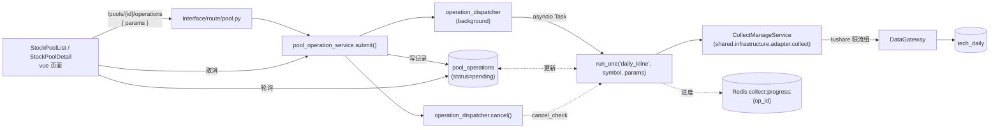

# 用户与操作池 · 概要（`user` context）

> 面向"需要快速理解自选股池（操作池）的数据模型、批量采 K 线流程和接入点的开发者"。
> DDD 位置：`backend/src/contexts/user/`（`interface` → `application` → `domain` ← `infrastructure`）。
> 跨 context 依赖：通过 `shared.infrastructure.adapter.collect` 复用采集框架（`run_one` 调 K 线采集）；通过 `market.application.service.stock_info_service` 校验股票存在性。

页面：`frontend/src/views/stock-pool/*`（列表 / 详情 / 信号摘要）
应用服务：`backend/src/contexts/user/application/service/{pool_service, pool_operation_service}.py`
后台调度：`backend/src/shared/infrastructure/adapter/background/operation_dispatcher.py`（池内批量采 K 线）
接口：`/api/v1/pools/*`、`/api/v1/operations/*`

最后更新：2026-10-17（step7 统一 DDD 重构后）

---

## 1. 现状一句话

"操作池"是用户的自选股分组（`stock_pools` + `stock_pool_members`），可对池内股票发起批量 K 线采集（`pool_operations` 后台任务），操作由 `operation_dispatcher` 异步执行（`run_one("daily_kline", symbol, ...)`），进度写 Redis 复用采集框架的进度通道。池与成员支持 CRUD、归档、按 symbol 反查（`/pools/by-symbol/{symbol}`）。鉴权当前阶段保持公开（与业务路由一致），后续按 `pool:read / pool:write / pool:delete` 收紧。

## 2. 目录结构

```
backend/src/contexts/user/
├── domain/
│   ├── entity/                  # StockPool / StockPoolMember / PoolOperation 实体
│   ├── vo/                      # PoolType（manual / system / archived）等值对象
│   └── repository.py            # StockPoolRepo / StockPoolMemberRepo / PoolOperationRepo
├── application/
│   ├── dto/                     # 业务编排用的内部 DTO（与 interface/dto 解耦）
│   └── service/
│       ├── pool_service.py              # 池与成员的 CRUD + 业务规则
│       └── pool_operation_service.py    # 池操作：发起 / 进度 / 取消
├── infrastructure/
│   ├── di/                      # di_user.py（DI 注册）
│   └── persistence/
│       ├── models/pool.py       # ORM（StockPoolDB / StockPoolMemberDB / PoolOperationDB）
│       └── repositories/pool_repository.py  # 仓储实现
└── interface/
    ├── route/pool.py            # /pools / /operations 路由
    └── dto/                     # 请求 / 响应 DTO
```

跨 context：
- **采集复用**：`pool_operation_service` 通过 `shared.infrastructure.adapter.collect` 的 `CollectManageService.run_one("daily_kline", ...)` 执行单只 K 线采集，复用 `tushare` 限流组 + 重试 + 进度；
- **股票存在性**：`pool_service` 写成员前调 `market.application.service.stock_info_service` 校验 `symbol` 存在；
- **后台调度**：`shared.infrastructure.adapter.background.operation_dispatcher` 是真正的"并发跑 K 线"协程调度器，`pool_operation_service.submit()` 把任务丢给它；
- **路由聚合**：`pool.py` 的路由被 `shared.interface.router_compat.api_router` 挂到 `/api/v1`。

## 3. 数据模型

| 表 | 关键字段 | 说明 |
|---|---|---|
| `stock_pools` | PK `id` · `name` · `pool_type`（`manual` / `system` / `archived`）· `description` · `created_at` / `updated_at` | 池定义；`system` 类型由 seed 写入（如"默认操作池"），`archived` 表示归档池（成员保留但不再反查） |
| `stock_pool_members` | PK `id` · FK `pool_id`（CASCADE）· `symbol` · `note` · UK `(pool_id, symbol)` | 池与股票的 N:N 关联；唯一约束避免重复添加 |
| `pool_operations` | PK `id` · FK `pool_id` · `status`（`pending` / `running` / `success` / `failed` / `cancelled`）· `total` / `success` / `fail` · `message` · `trigger_type`（`manual`）· `created_at` / `started_at` / `ended_at` | 池操作记录：一次"池内批量采 K 线"对应一行；`pool_id` + 池内 symbol 列表共同决定单元 |

> 行数为 2026-10-13 实测：`stock_pools` 2 / `stock_pool_members` 21 / `pool_operations` 6。

## 4. API 列表

| 方法 | 路径 | 鉴权 | 用途 |
|---|---|---|---|
| `GET` | `/api/v1/pools/` | 公开 | 池列表（分页 + 关键字 + 类型筛选） |
| `POST` | `/api/v1/pools/` | 公开 | 新建池（`name` / `pool_type` / `description`） |
| `GET` | `/api/v1/pools/{id}` | 公开 | 池详情（含成员列表） |
| `PATCH` | `/api/v1/pools/{id}` | 公开 | 修改名称 / 描述 / 类型 |
| `DELETE` | `/api/v1/pools/{id}` | 公开 | 删除池（成员级联） |
| `GET` | `/api/v1/pools/{id}/members` | 公开 | 成员列表（分页） |
| `POST` | `/api/v1/pools/{id}/members` | 公开 | 批量添加成员（`symbols: [...]`） |
| `DELETE` | `/api/v1/pools/{id}/members/{symbol}` | 公开 | 移除单个成员 |
| `PATCH` | `/api/v1/pools/{id}/members/{symbol}` | 公开 | 修改成员备注 |
| `GET` | `/api/v1/pools/by-symbol/{symbol}` | 公开 | 反查某股票在哪些池中（排除 `archived`） |
| `POST` | `/api/v1/pools/{id}/operations` | 公开 | 发起池操作（默认 `daily_kline` 批量采 K 线；`params` 透传 `CollectManageService.run_one`） |
| `GET` | `/api/v1/operations/{id}` | 公开 | 池操作详情（进度） |
| `POST` | `/api/v1/operations/{id}/cancel` | 公开 | 取消池操作 |

> 鉴权待按 `pool:read / pool:write / pool:delete` 收紧（见 `登录概要.md` §12 / `rbac权限概要.md` §6 阶段 3）。

## 5. 执行链路（池内批量采 K 线）



- **参数优先级**：调用方传入 > 操作默认值（`daily_kline` 时 `params = {"days": 7}`）；
- **限流**：每个单元的 `run_one` 复用采集框架的 `tushare` 限流组（`COLLECT_MAX_CONCURRENCY` + 0.15s 间隔）；
- **取消**：取消标志写在 `operation_dispatcher` 进程内（单进程假设），单元之间检查；`context.cancel_check` 也会让限频 / 重试等待及时中断；
- **进度**：`pool_operations` 行 + Redis `collect:progress:{op_id}`（同采集任务）。

## 6. 业务规则

| 规则 | 说明 |
|---|---|
| 池名 UK | 同用户下 `name` 不重复（`stock_pools.name` 唯一） |
| 成员 UK | `(pool_id, symbol)` 唯一，重复添加静默忽略 |
| 系统池保护 | `pool_type=system` 的池不可删除（`pool_service.delete` 抛 `DomainError`） |
| 归档池 | `pool_type=archived` 不出现在 `/pools/by-symbol/{symbol}` 的反查结果中 |
| 股票存在性 | 成员添加前必须 `fundamental_stock_basic` 里有该 `symbol` |
| 池操作单元 | 池内每只 symbol 一个单元；全部完成后 `status=success`（`success > 0` 且 `fail == 0`），有失败则 `failed` |

## 7. 关键代码位置

| 类 / 模块 | 路径 | 说明 |
|---|---|---|
| `StockPool` / `StockPoolMember` / `PoolOperation` | `contexts/user/domain/entity/` | 实体 |
| `StockPoolRepo` / `StockPoolMemberRepo` / `PoolOperationRepo` | `contexts/user/domain/repository.py` | 仓储接口 |
| `PoolService` | `contexts/user/application/service/pool_service.py` | 池与成员 CRUD + 业务规则 |
| `PoolOperationService` | `contexts/user/application/service/pool_operation_service.py` | 池操作：发起 / 进度 / 取消 |
| `OperationDispatcher` | `shared/infrastructure/adapter/background/operation_dispatcher.py` | 池操作后台任务调度器 |
| `StockPoolDB` / `StockPoolMemberDB` / `PoolOperationDB` | `contexts/user/infrastructure/persistence/models/pool.py` | ORM |
| `pool_repository.py` | `contexts/user/infrastructure/persistence/repositories/pool_repository.py` | 仓储实现 |
| `pool.py` | `contexts/user/interface/route/pool.py` | `/pools/*` + `/operations/*` |
| 前端 | `frontend/src/views/stock-pool/{StockPoolList, StockPoolDetail}.vue` | 列表 / 详情 |

## 8. 一句话

> `user` context 以"操作池"为单位承载用户的自选股 + 批量采 K 线需求，池与成员的 CRUD 走 `pool_service`，批量采集走 `pool_operation_service` → `operation_dispatcher` → `CollectManageService.run_one`，与采集框架共用限流 / 重试 / 进度 / 取消机制；数据 3 张表，鉴权暂保持公开，后续按 `pool:*` 权限收紧。
